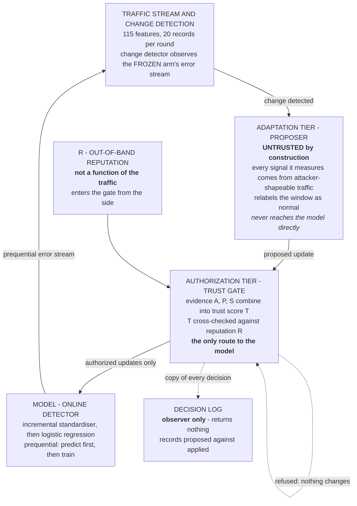
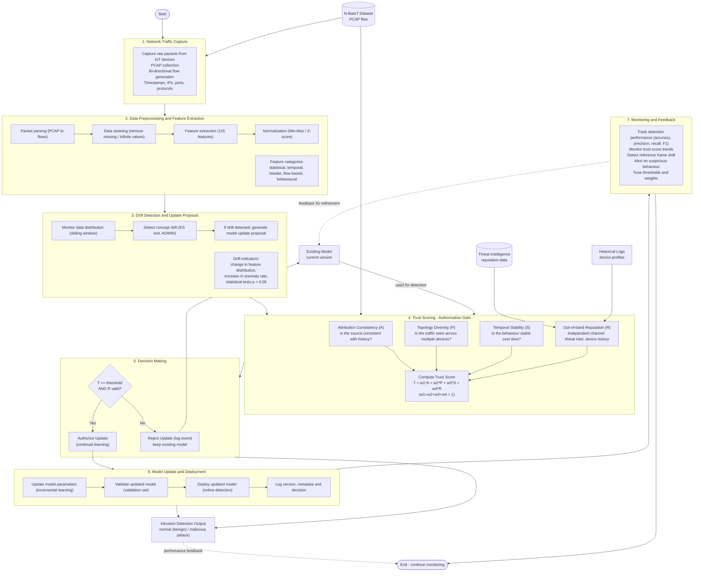
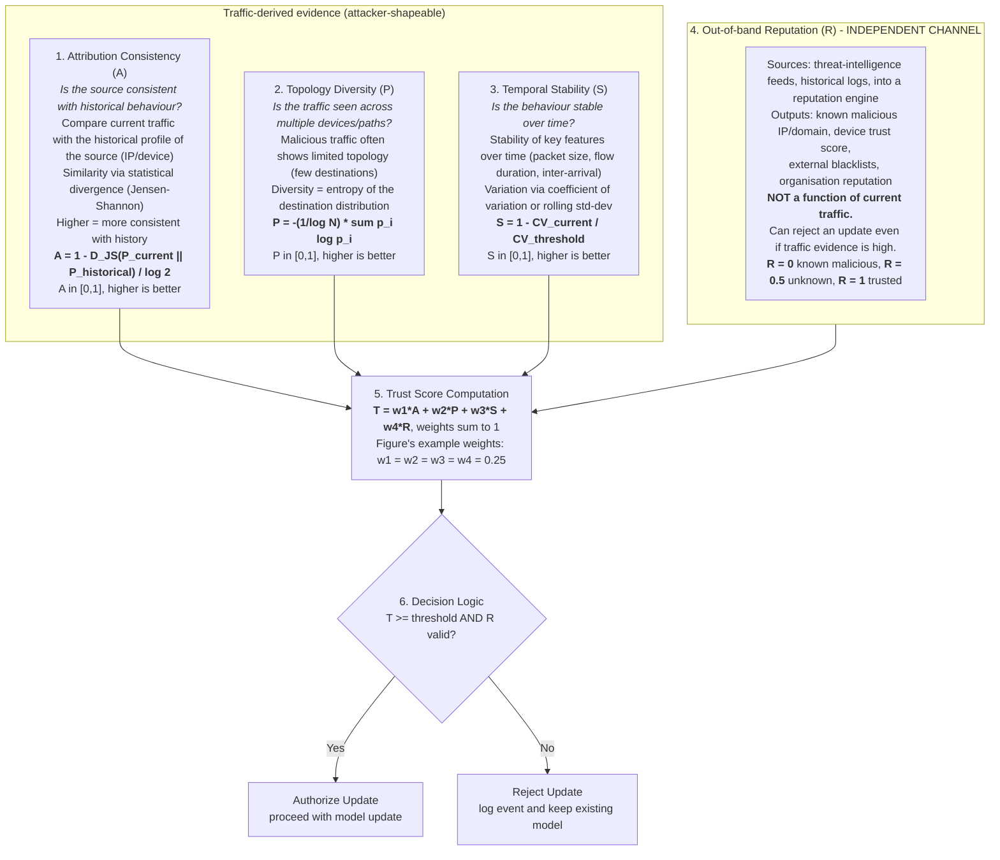
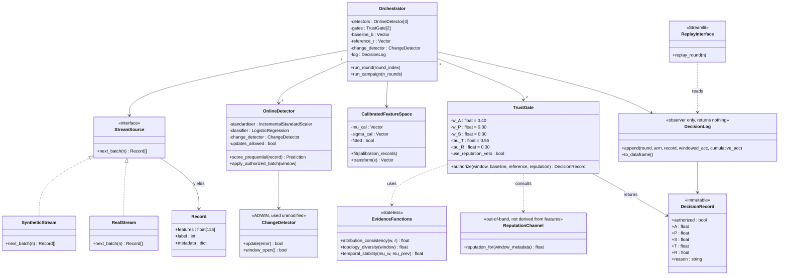
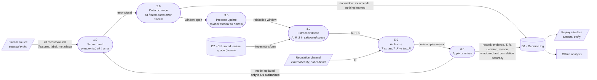
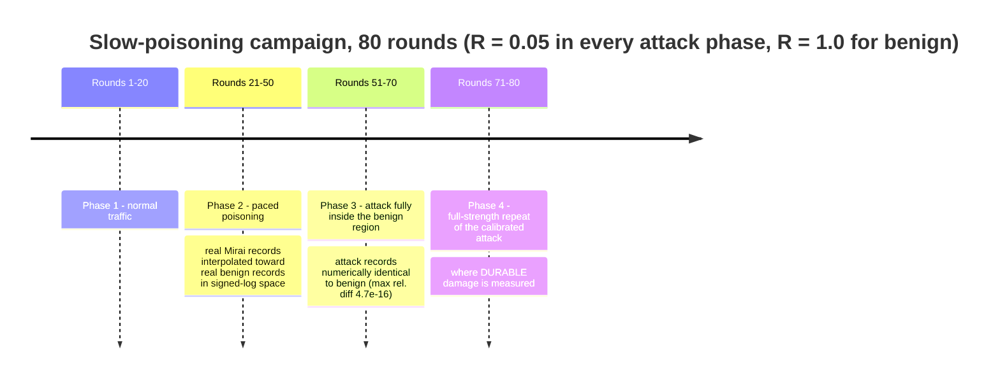

# context.md — Project Context for LLM Consumption

> **Purpose of this file.** A single, self-contained brief on the project in this folder, written
> for a language model that has not seen the source artefacts. It compresses `Project-1 Report.pdf`
> (25 pp.) and re-encodes the four PNG figures as Mermaid (`mmd`) diagrams so their content is
> readable as text rather than as pixels.
>
> **Source artefacts in this folder**
>
> | File | Content |
> |---|---|
> | `Project-1 Report.pdf` | Full Review-2 report: abstract, lit review, objectives, spec, design, experiments, conclusion, references |
> | `ChatGPT Image ... 06_54_54 PM.png` | Fig. 1 — Overall System Architecture |
> | `ChatGPT Image ... 06_55_26 PM.png` | Fig. 2 — Detailed Methodology Flowchart |
> | `ChatGPT Image ... 06_55_29 PM.png` | Fig. 3 — N-BaIoT Data Preprocessing Pipeline |
> | `ChatGPT Image ... 06_55_35 PM.png` | Fig. 4 — Trust Scoring Mechanism / Authorization Gate |
>
> **No source code is present in this folder** — only the report and the figures. All statements
> below about implementation are as-reported, not as-verified-from-code.

---

## 1. Project Identity

| Field | Value |
|---|---|
| **Title** | Trust-Aware Continual Learning for IoT Intrusion Detection: An Evidence-Based Authorization Gate Against Slow Poisoning |
| **Course code** | BCSE497J — Project-I |
| **Institution** | Vellore Institute of Technology (VIT), School of Computer Science and Engineering (SCOPE) |
| **Degree** | B.Tech. Computer Science and Engineering |
| **Team** | 23BCE2326 Mohanish Gupta · 23BCE0045 Saarthak Tripathi · 23BCI0113 Akarsh Dixit |
| **Supervisor** | Dr. Naveen Kumar S (Associate Professor Grade 2) |
| **Date** | September 2026 |
| **Stage** | Review 2 (Project-I complete; Project-II future work enumerated) |
| **Keywords** | intrusion detection; continual learning; concept drift; data poisoning; adversarial ML; authorization; runtime assurance; out-of-band verification; N-BaIoT; prequential evaluation; negative results; reproducibility |

---

## 2. The Crux (30-second version)

An IDS that **keeps learning after deployment** can be **taught the wrong thing**. A patient
adversary paces malicious traffic so its statistical signature migrates slowly toward the benign
region until the detector absorbs the attack into its own notion of "normal". Existing defences
judge a proposed model update by **inspecting the training data itself** — but the attacker
*controls* that data, and therefore controls the evidence.

**The contribution is architectural, not statistical:** insert an explicit **authorization gate**
between *drift detection* and *model update*, and give that gate one deciding input that is **not a
function of the traffic** — an out-of-band **reputation channel (R)**. The gate may refuse an
update no matter how healthy the traffic-derived evidence looks.

**Headline result (real N-BaIoT traffic, 80 rounds, slow-poisoning campaign):**

- Traffic-only gate: accepted **5 of 24** poisoned proposals → repeat-attack detection collapsed to **0.200**.
- Proposed gate (traffic evidence + out-of-band veto): refused **all 24** → repeat-attack detection **1.000**.
- **At round 40 both gates saw numerically identical evidence** (A=0.500, P=0.784, S=0.459, T=0.573)
  and reached **opposite decisions**. Only the independent channel separated them. *That single row is the whole result.*

**Second finding — poisoning is self-reinforcing.** Having accepted one poisoned update, the
traffic-only gate advanced its own baseline `b` and reference direction `r` *using a poisoned
window*. Later poisoned windows then resembled that poisoned reference, inflating its attribution
score from the neutral 0.500 up to **0.956 / 0.753 / 0.770 / 0.777**. **Accepting one unauthorized
update makes accepting the next more likely.** The design rule that *a refusal changes nothing at
all* — not the model, not the baseline, not the reference direction — is what breaks that loop, and
is why the proposed arm ends **numerically identical to the frozen arm** rather than merely better
than the ungated one.

**Two negative results are reported rather than withheld** (see §15).

---

## 3. Problem Statement & Research Gap

### Problem statement (as written)

> Given an IDS that continues to learn from live traffic, and an adversary aware of that fact and
> willing to act slowly, interpose a **deterministic authorization stage** between change detection
> and model update, and answer two questions by measurement:
>
> 1. Can **traffic-derived evidence alone** distinguish legitimate adaptation from a paced poisoning campaign?
> 2. If not, does a signal that is **not a function of the traffic** recover the distinction — and
>    what is the measurable cost of having got that decision wrong *once the attack has ended*?

### Three identified gaps

1. **No explicit authorization stage.** In the standard adaptive pipeline, a detected change point
   leads *directly* to a model update. The decision is never represented as a decision, so it cannot
   be constrained, recorded, or refused.
2. **Defences confined to the attacker's own channel.** Trimmed-loss defences trim the training set;
   EWC anchors against the training signal; drift detectors watch an error stream the poisoned data
   itself produces. Each measures a quantity the adversary is shaping — a patient adversary can
   satisfy all of them at once.
3. **Damage measured only during the attack.** Poisoning is usually scored by accuracy *during* the
   attack window. The consequential question — *can the detector still recognise an unmistakable
   instance of the original attack afterwards?* — distinguishes temporary evasion from durable corruption.

### What is explicitly NOT claimed

The streaming classifier, the change detector, and the poisoning strategy are all **existing
techniques used as published**. The contribution is *the interposition of an authorization decision
whose deciding input is not a function of the traffic being judged*, plus an honest measurement of
what happens when that decision is delegated to traffic-derived evidence alone.

---

## 4. Threat Model

| Aspect | Value |
|---|---|
| Attack class | **Causative / training-time (poisoning)**, not exploratory/evasion |
| Adversary goal | Move the decision boundary, not evade it |
| Adversary capability | Shapes traffic features; knows the detector adapts; is **patient** |
| Key property | Damage **persists after the attack traffic stops** |
| Adversary limitation (the defence's leverage) | Cannot shape the out-of-band reputation channel `R` |

---

## 5. Figure 1 → Mermaid: Overall System Architecture

*(Re-encoding of `ChatGPT Image ... 06_54_54 PM.png`. This is the **conceptual/presentation**
architecture; see §19 for where it differs from the implemented system.)*

```mermaid
flowchart LR
    subgraph SRC["IoT Network Traffic"]
        DEV["IoT Devices<br/>camera, bulb, router, thermostat<br/>e.g. N-BaIoT"]
    end

    subgraph P1["1. Data Preprocessing and Feature Extraction"]
        P1a["Packet parsing (PCAP)"]
        P1b["Flow generation (bi-directional)"]
        P1c["Feature extraction (115 features)"]
        P1d["Data cleaning and normalization"]
        P1a --> P1b --> P1c --> P1d
    end

    subgraph P2["2. Drift Detection and Update Proposal"]
        P2a["Monitor data distribution"]
        P2b["Detect concept drift (statistical tests)"]
        P2c["Generate model update proposal"]
        P2a --> P2b --> P2c
    end

    subgraph P3["3. Authorization Gate - Trust Scoring"]
        EA["Attribution Consistency (A)"]
        EP["Topology Diversity (P)"]
        ES["Temporal Stability (S)"]
        ER["Out-of-band Reputation (R)"]
        TS["Trust Score T<br/>T = w1*A + w2*P + w3*S + w4*R"]
        EA --> TS
        EP --> TS
        ES --> TS
        ER --> TS
    end

    subgraph P4["4. Decision Module"]
        DEC{"T >= threshold<br/>AND R valid?"}
        OK["Authorize Update<br/>(continual learning)"]
        NO["Reject Update<br/>(log event)"]
        DEC -- "Yes" --> OK
        DEC -- "No" --> NO
    end

    subgraph P5["5. Model Update and Online Learning"]
        M1["Incremental model update"]
        M2["Update model parameters"]
        M3["Maintain version history"]
        M4["Log decisions and metadata"]
    end

    subgraph P6["6. Intrusion Detection Output"]
        O1["Normal traffic (benign)"]
        O2["Malicious traffic (attack)"]
    end

    subgraph P7["7. Monitoring and Feedback"]
        F1["Track detection performance (F1, recall)"]
        F2["Monitor trust score trends"]
        F3["Detect reference frame shift"]
        F4["Alert on suspicious behaviour"]
        F5["Feedback for threshold tuning"]
    end

    DEV -- "network packets" --> P1 --> P2 --> P3 --> P4
    OK --> P5
    P4 --> P6
    P5 --> P6
    P5 --> P7
    P7 -. "feedback loop: performance monitoring and model refinement" .-> DEV
```



### 5b. The **as-implemented** three-tier architecture (report §4.1)

The distinguishing structural claim: **exactly one route from a proposed update to the model**, and
two components deliberately **outside** that route.



**Invariants encoded in this picture**

- The reputation channel enters **from outside the traffic path** and is never derived from the window.
- The decision log **returns nothing**, so it cannot influence what the model learns.
- The change trigger observes the **frozen** arm, so no arm's own decisions can corrupt the trigger for the others.
- A **refused** update alters nothing: not the model, not the trusted baseline `b`, not the reference direction `r`.

---

## 6. Figure 2 → Mermaid: Detailed Methodology Flowchart

*(Re-encoding of `ChatGPT Image ... 06_55_26 PM.png` — data ingestion through to model-update decision.)*



---

## 7. Figure 3 → Mermaid: N-BaIoT Data Preprocessing Pipeline

*(Re-encoding of `ChatGPT Image ... 06_55_29 PM.png`.)*

```mermaid
flowchart LR
    subgraph A["1. Raw Packet Capture (PCAP)"]
        A1["Capture traffic from IoT device<br/>N-BaIoT - Danmini Doorbell"]
        A2["Tools: tcpdump, Wireshark"]
        A3["Benign plus malicious (Mirai) traffic"]
        A4["Timestamps, IPs, ports, protocols,<br/>packet sizes, payloads"]
        AEX["Example raw packet:<br/>2020-08-14 08:12:34.123<br/>192.168.1.2 to 192.168.1.100<br/>TCP | 345 bytes"]
    end

    subgraph B["2. Flow Generation (bi-directional)"]
        B1["Aggregate packets into bi-directional flows<br/>5-tuple: src IP, dst IP, src port, dst port, protocol"]
        B2["Compute flow-level statistics:<br/>duration, packet count, bytes, inter-arrival time"]
        B3["Bidirectional flows capture request AND response"]
        BEX["Example flow:<br/>192.168.1.2:3456 to 192.168.1.100:80<br/>TCP, 2.34 s, 25 packets (12 fwd, 13 bwd), 15,430 bytes"]
    end

    subgraph C["3. Feature Extraction - 115 features"]
        C1["Statistical features (20)"]
        C2["Temporal features (15)"]
        C3["Header features (20)"]
        C4["Flow-based features (40)"]
        C5["Behavioural features (20)"]
        CN["Packet-size stats, inter-arrival times,<br/>flag counts, flow duration, sub-flow metrics"]
    end

    subgraph D["4. Data Cleaning and Normalization"]
        D1["Remove missing values"]
        D2["Handle outliers (IQR / Z-score)"]
        D3["Remove infinite values"]
        D4["Normalize features (Min-Max / Z-score)<br/>x' = (x - x_min) / (x_max - x_min)"]
        D5["Final feature matrix (115 features)"]
        D1 --> D2 --> D3 --> D4 --> D5
    end

    subgraph E["5. Processed Dataset"]
        E1["Benign records: 49,548<br/>Mirai records: 107,685<br/>Total: 157,233<br/>Features: 115<br/>Missing values: 0<br/>Infinite values: 0"]
        E2["Feature matrix sample: F1 to F115 plus Label<br/>Label: 0 = Benign, 1 = Mirai (attack)"]
    end

    A --> B --> C --> D --> E
    E -. "processed data used for model training, evaluation and online detection" .-> A
```



**Dataset facts actually used in the evaluation (report §4.3.2)**

| Quantity | Value |
|---|---|
| Primary device | **Danmini Doorbell** (N-BaIoT) |
| Benign records | 49,548 |
| Mirai *scan* records | 107,685 |
| Gafgyt *combination* records | 59,718 |
| Features | 115 numeric |
| Integrity checks | 0 missing, 0 infinite, identical column ordering across all three files |
| Negative-valued columns | **20 of 115** → the log transform must be **signed**, not absolute |
| Second operating point | **Ennio Doorbell** benign, 39,100 records |
| On-disk size | ≈ 285 MB of capture files |

---

## 8. Figure 4 → Mermaid: Trust Scoring Mechanism (Authorization Gate)

*(Re-encoding of `ChatGPT Image ... 06_55_35 PM.png`. Formulas shown here are the **figure's**
conceptual definitions; the **implemented** formulas are in §9 and differ — see §19.)*



---

## 9. The Mechanism **As Implemented** (report §4.3.1) — authoritative

### 9.1 Calibrated feature space (fitted once, then frozen)

```
z = [ sgn(x) * log(1 + |x|) - mu_cal ] / sigma_cal          (4.1)
```

Fitted on **calibration benign records only** and **never refitted on live windows** — so the
adversary cannot move the reference frame. `sgn(·)` is required because 20 of the 115 columns take
negative values.

### 9.2 Evidence signals

For a window with mean `mu_w`, trusted baseline `b`, previous window mean `mu_{w-1}`, reference
direction `r`:

```
w  = mu_w - b                                      (window displacement)

A  = clip( (1 + cos(angle(w, r))) / 2 , 0, 1 )     attribution consistency   (4.2)
     -> returns the NEUTRAL value 0.5 while r is undefined

P  = -sum_i p_i ln p_i / ln K ,   K = 9            topology diversity        (4.3)

S  = 1 / (1 + ||mu_w - mu_{w-1}||)                 temporal stability        (4.3)
```

### 9.3 Trust score and authorization rule (note: **R is a veto, not a weighted term**)

```
T = 0.40*A + 0.30*P + 0.30*S

auth = false            if R < tau_R          <- veto, independent of T
     = [ T >= tau_T ]   otherwise

tau_T = 0.55   (trust threshold)
tau_R = 0.30   (reputation veto threshold)
```

### 9.4 State update — **on acceptance only**

```
r <- 0.7*r + 0.3*w        (reference direction, EMA)
b <- mu_w                 (trusted baseline)
```

On **refusal, nothing is mutated at all.** This is the single design rule that prevents the
self-reinforcing poisoning loop described in §2 and §14.2.

---

## 10. UML: Class Diagram

*(The report marks this "optional" and describes it in prose (§4.2.3) rather than drawing it; the
diagram below is the faithful Mermaid rendering of that prose.)*



**Notes not expressible in the diagram syntax:** `CalibratedFeatureSpace` **deliberately provides no
`refit()`** (trust-boundary integrity). `OnlineDetector.score_prequential` predicts **before**
training. `Record.metadata` carries ground-truth origin, consumed **only** by `ReputationChannel`,
never by the evidence functions. The four `OnlineDetector` instances differ in exactly one property
each (see §13.1); the two `TrustGate` instances differ only in `use_reputation_veto`.

---

## 11. DFD: Level-1 Data Flow Diagram — one adaptation round

*(Re-encoding of report Fig. 4.2, §4.2.1. Classic Yourdon/DeMarco numbering: processes 1.0–6.0,
data stores D1/D2, external entities as terminators.)*



**Read carefully:** *Process 6.0 writes back to the model **only** when process 5.0 authorized the
update.* A refused decision alters **nothing at all** — no model weights, no baseline `b`, no
reference direction `r`.

---

## 12. UML: Sequence Diagram — one adaptation round

*(Re-encoding of report §4.2.4, also described in prose rather than drawn.)*

```mermaid
sequenceDiagram
    autonumber
    participant SRC as Stream source
    participant ORC as Orchestrator
    participant FRZ as Arm 1 - Frozen
    participant UNG as Arm 2 - Ungated
    participant TGO as Arm 3 - Traffic-only gate
    participant PRO as Arm 4 - Proposed gate
    participant CD as Change detector (ADWIN)
    participant FS as Calibrated feature space
    participant REP as Reputation channel
    participant LOG as Decision log

    ORC->>SRC: draw 20 records
    SRC-->>ORC: window of records

    loop for every record (prequential: predict, then train)
        ORC->>FRZ: predict and score
        ORC->>UNG: predict and score
        ORC->>TGO: predict and score
        ORC->>PRO: predict and score
        FRZ-->>CD: error signal (frozen arm ONLY - trigger independence)
    end

    ORC->>CD: is a change window open?

    alt no window open
        CD-->>ORC: closed
        ORC->>LOG: log round - nothing proposed, nothing learned
    else window open
        CD-->>ORC: open (bounded 15-round adaptation window)
        ORC->>ORC: construct proposal - relabel every record in window as normal
        ORC->>FS: transform window into calibrated space (frozen transform)
        FS-->>ORC: z-window

        Note over ORC,PRO: Arm 1 never learns; Arm 2 learns unconditionally

        ORC->>TGO: compute A, P, S against THIS arm's own b and r
        TGO-->>ORC: DecisionRecord (T vs tau_T only, no veto)

        ORC->>REP: reputation for this window
        REP-->>ORC: R
        ORC->>PRO: compute A, P, S against THIS arm's own b and r, plus R
        PRO-->>ORC: DecisionRecord (veto if R < tau_R, else T vs tau_T)

        alt decision = authorized
            ORC->>TGO: apply batch to model
            ORC->>TGO: advance baseline b = mu_w, reference r = 0.7r + 0.3w
        else decision = refused
            ORC-->>TGO: do nothing at all (model, b and r all unchanged)
        end

        ORC->>LOG: append every arm's outcome - evidence, T, R, decision, reason, accuracies
    end
```

---

## 13. Experimental Design

### 13.1 The four arms — identical data, identical trigger, **one property differing each**

| # | Arm | Behaviour |
|---|---|---|
| 1 | **Frozen** ("never learns") | Never updates — the control |
| 2 | **Ungated** ("learns from everything") | Accepts every proposal — the worst case |
| 3 | **Traffic-only gate** ("checks traffic only") | Applies `T >= 0.55`, **no veto** — represents existing evidence-based gating |
| 4 | **Proposed gate** | `T >= 0.55` **plus** the out-of-band reputation veto `R >= 0.30` |

### 13.2 Protocol

- 400 calibration records, then **80 rounds × 20 records**, prequential throughout (predict-then-train, never a label before its prediction is scored).
- A detected change point opens a **bounded 15-round adaptation window**.
- Change trigger driven by the **frozen** arm for all four arms (trigger independence).
- All sampling seeded → deterministic re-run.

### 13.3 Slow-poisoning scenario — four phases



> **Why interpolate in signed-log space?** Linear interpolation in *raw* space is dominated by the
> columns of order 10^17 and degenerates into a *sudden* attack preceded by a long flat prefix —
> which is not the threat model under study. Every endpoint is genuine captured traffic; only the
> **schedule** is constructed.

---

## 14. Results

### 14.1 Headline — slow poisoning on real traffic (Table 4.2)

| Arm | Accuracy | F1 | **Repeat-attack detection** | Updates accepted |
|---|---|---|---|---|
| Never learns (frozen) | 0.5531 | 0.5757 | **1.000** | 0 of 80 |
| Learns from everything (ungated) | 0.4531 | 0.4262 | **0.200** | 24 of 80 |
| Checks traffic only | 0.4531 | 0.4262 | **0.200** | **5 of 80** |
| **Proposed gate** | 0.5531 | 0.5757 | **1.000** | **0 of 80** |

*Repeat-attack detection = mean windowed accuracy over rounds 71–80. The divergence at round 73 is the whole result.*

> **Why every arm scores ~0 from round 36 to 70 — and why that is not a failure.** By round 36 the
> paced interpolation has carried the attack traffic across the decision boundary; in phase 3 the
> attack records are **numerically identical to benign records** (verified to a maximum relative
> difference of **4.7 × 10⁻¹⁶**) while still carrying an attack label. No detector inspecting only
> traffic can score above zero there — *including the frozen arm, which never updated at all.*
> **This is why overall accuracy is a poor headline and repeat-attack detection is the meaningful figure.**

### 14.2 What separated the two gates (Table 4.3) — the five disagreement rounds

| Round | Gate | A | P | S | T | R | Decision |
|---|---|---|---|---|---|---|---|
| **40** | traffic-only | **0.500** | **0.784** | **0.459** | **0.573** | 0.05 | **accepted** |
| **40** | proposed | **0.500** | **0.784** | **0.459** | **0.573** | 0.05 | **refused** |
| 72 | traffic-only | 0.956 | 0.480 | 0.509 | 0.679 | 0.05 | accepted |
| 72 | proposed | 0.500 | 0.480 | 0.509 | 0.497 | 0.05 | refused |
| 73 | traffic-only | 0.753 | 0.480 | 0.555 | 0.612 | 0.05 | accepted |
| 73 | proposed | 0.500 | 0.480 | 0.555 | 0.510 | 0.05 | refused |
| 74 | traffic-only | 0.770 | 0.306 | 0.633 | 0.590 | 0.05 | accepted |
| 74 | proposed | 0.500 | 0.306 | 0.633 | 0.482 | 0.05 | refused |
| 75 | traffic-only | 0.777 | 0.306 | 0.633 | 0.593 | 0.05 | accepted |
| 75 | proposed | 0.500 | 0.306 | 0.633 | 0.482 | 0.05 | refused |

- **Round 40 is the controlled comparison.** Both gates held the same calibration baseline (neither
  had yet accepted anything), so the evidence is *numerically identical*. `T = 0.573` cleared
  `tau_T = 0.55`. The traffic-only gate accepted; the proposed gate refused because `R = 0.05 < tau_R = 0.30`.
  **Nothing but the independent channel distinguishes the two decisions.**
- **Rounds 72–75 show the feedback loop.** After accepting at round 40 the traffic-only gate advanced
  `b` and initialised `r` from a *poisoned* window; subsequent poisoned windows then resembled that
  poisoned reference, inflating `A` to 0.956 / 0.753 / 0.770 / 0.777 and carrying `T` above threshold
  on each round of the repeat attack. The proposed gate's `A` stayed **pinned at exactly 0.500** all
  run — its reference direction was never initialised, because it never authorized anything.

### 14.3 The defect found during integration (Table 4.1) — a methodological highlight

The three evidence signals are **geometric** (angles and norms between window-mean vectors), which is
meaningful **only if features contribute on comparable scales**. On synthetic data this held
trivially. On real data it failed badly:

- Calibration-block feature standard deviations span **6.6 × 10⁻³ to 3.2 × 10¹⁶**; individual feature
  maxima reach **5.67 × 10¹⁷** — roughly **nineteen orders of magnitude**.
- Applying the evidence functions to raw vectors gives **S = 1.7 × 10⁻¹⁷** (window displacement
  magnitude 5.79 × 10¹⁶) → **the entire 0.30 weight on temporal stability is dead in every round, for every arm.**
- **Five** jitter-variance columns account for 71.8 / 11.6 / 6.6 / 5.4 / 4.6 % of the displacement
  vector's squared norm — **100.0 % to one decimal place** — so a nominal 115-feature cosine
  similarity is in reality a **one-feature measurement**.

| Feature space | A | P | S | T | Decision |
|---|---|---|---|---|---|
| Raw features | 1.0000 | 0.4318 | 1.7 × 10⁻¹⁷ | 0.5295 | **refused** (a genuinely benign window) |
| Signed logarithm, calibrated | 0.9097 | 0.8292 | 0.2572 | 0.6898 | **authorized** |

**Consequence had it gone unnoticed:** nothing would ever have been authorized, all four arms would
have degenerated to the frozen arm, and the experiment would have shown nothing at all — *while still
running to completion and producing plausible-looking output.* It was found by evaluating the
evidence functions **directly on real windows**, not by inspecting end-to-end accuracy.

### 14.4 Cross-check on the synthetic stream (Table 4.5) — the pattern reproduces

| Arm | Accuracy | F1 | Repeat attack | Updates accepted |
|---|---|---|---|---|
| Never learns (frozen) | 0.6294 | 0.6718 | 1.000 | 0 of 80 |
| Learns from everything | 0.5256 | 0.5375 | 0.200 | 37 of 80 |
| Checks traffic only | 0.5256 | 0.5375 | 0.200 | 11 of 80 |
| Proposed gate | 0.6294 | 0.6718 | 1.000 | 0 of 80 |

On the synthetic stream the **genuine-drift** scenario *does* exercise the gate: the frozen arm falls
to 0.000 after the drift while the three adaptive arms recover to 1.000, and the proposed gate
authorizes on **13 of 70** rounds — **exactly as many as the traffic-only gate**, confirming that the
veto **does not obstruct clean-reputation traffic**.

---

## 15. Negative Results (reported, not withheld)

### 15.1 Genuine benign drift produced no adaptation at all (Objective O7 — NOT ACHIEVED)

| Arm | Accuracy | Post-drift | Updates accepted | Change windows |
|---|---|---|---|---|
| All four arms (identical) | 0.9979 | 0.993 | 0 of 70 | **0** |

- The Danmini benign capture is **stationary**: distance between its 1st and 10th decile blocks is
  **0.16**, while *consecutive* blocks differ by **0.30–0.74** — the endpoints are closer together
  than neighbours are. Splitting that file yields no drift to detect.
- The Ennio Doorbell provides a genuinely different benign operating point at **5.7 σ** in the
  calibrated space — about **36× larger** — and *still* nothing happened.
- **Why:** the change detector observes an **error stream**. A benign→benign shift, however large in
  feature space, never crosses the benign/Mirai decision boundary, so the frozen detector kept
  classifying correctly at 0.998 and produced no error signal. **Nothing degraded → nothing was
  proposed → the gate was never asked to decide.**
- **The report deliberately does not choose between two readings:** (a) the behaviour is correct — a
  detector that is still working need not adapt; (b) the trigger is wrong — a **distribution-based**
  change detector on the *input* rather than the *error* would have fired. Resolving this needs the
  experiment the project did not run, and it is **first** under future work.

### 15.2 The out-of-band signal is simulated

N-BaIoT carries **no destination address, no reputation field, no C2 cost indicator**. The reputation
channel is therefore **keyed to ground-truth traffic origin**. It is *not* derived from the feature
vector — which preserves independence *in principle* — but it is **closer to an oracle than a
deployed threat-intelligence feed would be.**

> **The defensible claim is therefore: what an authorization step achieves *once an independent
> signal exists* — not that this work detects the attacker.**

---

## 16. Objectives Status (Table 2.2)

| # | Objective | Criterion | Outcome |
|---|---|---|---|
| O1 | Build a prequential online detector with change detection on real IoT traffic | Predict-then-train for every record; no label before prediction | **Achieved** — 115-feature stream, 80 rounds |
| O2 | Define traffic-derived trust evidence and quantify its limits | Three signals on the unit interval; adversary's ability to shape each stated | **Achieved** — all three shown shapeable |
| O3 | Establish the evidence layer is numerically sound on real data | Evidence must not be dominated by raw feature scale | **Achieved** — defect found and corrected |
| O4 | Interpose an authorization gate with an independent veto | The veto must be able to refuse an update the evidence approves | **Achieved** — five such refusals |
| O5 | Compare four arms through one orchestrator under slow poisoning | Identical data and trigger; one property differing per arm | **Achieved** — four arms, 80 rounds |
| O6 | Measure **durable** damage, not only damage during the attack | Detection of a full-strength repeat of the calibrated attack | **Achieved** — 0.200 against 1.000 |
| O7 | Demonstrate the gate does not obstruct legitimate drift | Genuine benign drift should be authorized, not refused | **NOT achieved** — no drift was triggered |
| O8 | Make the pipeline reproducible and demonstrable | Deterministic re-run; interactive replay of every decision | **Partially achieved** — replay delivered; **no test suite** |

---

## 17. Requirements (as derived from the implemented system)

**Functional** — stream ingestion (identical interface for synthetic and real sources) · prequential
evaluation · change detection on the frozen arm with a bounded adaptation window · evidence
extraction in a calibrated, frozen feature space · authorization with recorded reason · **independent
veto** · **null effect of refusal** · controlled four-arm comparison · per-round/per-arm decision
logging (every evidence value, T, R, decision, reason, windowed + cumulative accuracy) · round-by-round replay.

**Non-functional** — determinism (all sampling seeded) · **trust-boundary integrity** (evidence space
fitted on calibration data only, never refitted on live windows) · **trigger independence** (the
change detector observes an arm that never updates) · auditability (every decision explainable from
stored records without re-running) · portability (commodity hardware, no GPU, no cloud) · numerical
soundness (geometric evidence only in a comparably-scaled space).

---

## 18. Stack & Environment

| Category | Software / Hardware |
|---|---|
| Language | **Python 3.13.7** |
| Streaming ML | **River 0.26.1** — incremental standardiser, logistic regression, ADWIN change detector, prequential accuracy & F1 |
| Numerics | NumPy 2.5.3 · pandas 3.0.5 · SciPy 1.18.1 |
| Interactive interface | **Streamlit 1.63.0** with Altair charts (round-by-round decision replay) |
| Static plotting | Matplotlib 3.11.1 |
| Version control | Git, repository on GitHub (initialised **7 Sept 2026** — earlier development predates it, so the chronology is reconstructed from dated artefacts, not commit timestamps) |
| Processor | 12th-gen Intel Core i5-12500H (12 physical / 16 logical cores) |
| Memory | 15.7 GB |
| Graphics | NVIDIA RTX 3050 Laptop GPU **present but unused** — all computation is CPU-bound |
| OS | Windows 11 Home Single Language, build 10.0.26200, 64-bit |
| Storage | Local SSD, ≈ 285 MB of capture files |
| Network | Required only to download the dataset; all experiments run offline |
| Runtime | Full four-arm 80-round campaign on 115-feature traffic completes in **under two minutes** |

---

## 19. Figure-vs-Implementation Discrepancies (important for any downstream work)

The four PNGs are **conceptual/presentation** diagrams and do **not** match the implemented system in
several respects. When these conflict, **the report text (§9 above) is authoritative.**

| # | Figures say | Report / implementation says |
|---|---|---|
| 1 | `T = w1A + w2P + w3S + **w4R**`, weights sum to 1 — R is a **weighted term** | `T = 0.40A + 0.30P + 0.30S` — **R is a hard veto** (`R < 0.30` ⇒ refuse), deliberately *outside* the weighted sum. This separation is the point of the design. |
| 2 | Example weights `w1 = w2 = w3 = w4 = 0.25` | Implemented weights `0.40 / 0.30 / 0.30`, **untuned defaults chosen before any result was seen** |
| 3 | `A = 1 − D_JS(P_cur ‖ P_hist)/log 2` (Jensen-Shannon divergence) | `A = clip((1 + cos∠(w, r))/2, 0, 1)` — **cosine of the displacement against a reference direction**; neutral 0.5 while `r` is undefined |
| 4 | `S = 1 − CV_cur/CV_threshold` (coefficient of variation) | `S = 1/(1 + ‖mu_w − mu_{w−1}‖)` |
| 5 | `P` = entropy of a **destination-address** distribution, normalised by `log N` | `P = −Σ p_i ln p_i / ln K` with **K = 9** — N-BaIoT has **no destination field**, so "topology" is a proxy, not real topology |
| 6 | `R ∈ {0, 0.5, 1}` from live threat-intelligence feeds, blacklists, device history | `R` is **simulated**, keyed to ground-truth traffic origin: **0.05** in attack phases, **1.0** for benign. An **oracle**, not a feed. |
| 7 | PCAP capture → tcpdump/Wireshark → flow generation → 115 features | The project consumes N-BaIoT's **pre-extracted 115-feature CSVs**; no PCAP parsing was performed |
| 8 | Normalization = Min-Max / Z-score | **Signed-logarithm + calibration z-score**, `z = (sgn(x)·log(1+|x|) − mu_cal)/sigma_cal`. Min-Max would **not** have fixed the 19-orders-of-magnitude defect in §14.3 |
| 9 | Drift detection via "KS test / ADWIN" on the data distribution | **ADWIN on the frozen arm's error stream only.** This is precisely why the genuine-drift scenario produced a null result (§15.1) |
| 10 | Feature category counts (statistical 20, temporal 15, header 20, flow 40, behavioural 20) | Illustrative; the report only asserts **115 numeric features**, 20 of which take negative values |
| 11 | "Validate updated model on a validation set" | Not in the implemented pipeline — evaluation is **prequential**, with no held-out validation set |
| 12 | Feedback loop tunes thresholds and weights | **No hyper-parameter tuning was performed** — thresholds fixed before any result was seen |

---

## 20. Threats to Validity (as stated)

1. **The reputation channel is an oracle.** Keyed to ground-truth origin, it never errs. A deployed
   feed would be stale, incomplete and occasionally wrong; the gate's behaviour under an unreliable
   reputation is **entirely unmeasured**. *Single largest threat to external validity.*
2. **A single configuration.** One device, one attack family, one classifier, one set of untuned
   thresholds, one poisoning schedule. **No sensitivity analysis.**
3. **Small denominators.** The headline rests on **10 rounds** of repeat attack in a **single run**.
   No significance test is computed, and none would be supportable.
4. **The threshold was not calibrated.** `tau_T = 0.55` was chosen blind. Round 40 cleared it at 0.573 —
   a slightly higher threshold would have refused that update and the traffic-only arm might have
   survived. **Read the result as demonstrating a failure *mode*, not quantifying a failure *rate*.**
5. **No automated tests.** Claims verified by direct measurement; the code base has **no regression
   suite**, so silent breakage during future modification is unguarded.

Additional declared scope boundaries: attacker pacing is **constructed** (endpoints are real traffic,
the schedule is the authors'); one device family and one attack family; **no novelty claimed** in
drift detection or online learning; no costing/ROI study; no user study or human-subjects work.

---

## 21. Conclusion & Future Work

**Conclusion.** An authorization gate consulting a signal originating **outside the traffic channel**
refused a slow-poisoning campaign that defeated the equivalent gate without that signal. Beyond the
headline: (a) **traffic-derived evidence is insufficient in principle, not merely in practice** —
every component is measured from data the adversary shapes, and **no reweighting of the three signals
repairs that**; (b) **an unauthorized update is self-reinforcing**, which is why the design principle
that *a refusal changes nothing at all* matters more than the specific thresholds do.

**Future work, in the order it should be attempted:**

1. **A distribution-based change trigger** alongside the error-based one, so benign drift that does
   not degrade the detector still prompts a review — this is what turns §15.1's null result into a demonstration.
2. **A degraded reputation channel** — stale, incomplete, wrong — the only route by which the present
   oracle result becomes an engineering claim.
3. **An EWC baseline**, to separate *refusing a bad update* from *resisting forgetting* — a distinction
   the current comparison asserts but does not measure.
4. **Threshold and weight sensitivity**, converting a demonstrated failure mode into a quantified failure rate.
5. **Breadth** — further devices, further attack families, a non-linear classifier.

---

## 22. Literature Relied Upon (Table 2.1) and Reference Health

| Work | Contribution relied upon |
|---|---|
| Sommer & Paxson, IEEE S&P 2010 | Why ML underperforms specifically for intrusion detection; the evaluation traps this report avoids |
| Gama et al., ACM Computing Surveys 2014 | Vocabulary/taxonomy for concept drift; establishes that the adversarial case sits *outside* the standard framing |
| Bifet & Gavaldà, SIAM SDM 2007 | **ADWIN** — adaptive windowing over an error stream, used **unmodified** as this project's change detector |
| Montiel et al., JMLR 2021 | **River** — the streaming library providing incremental estimators and prequential metrics for all four arms |
| Meidan et al., IEEE Pervasive Computing 2018 | **N-BaIoT** dataset and its 115-feature streaming representation; also the source of the *absent* reputation field |
| Barreno et al., ACM ASIACCS 2006 | The causative vs. exploratory attack distinction naming this threat model |
| Nelson et al., USENIX LEET 2008 | Poisoning of a deployed, continually retraining classifier — closest prior threat |
| Biggio et al., ICML 2012 | The canonical optimisation-based poisoning attack against a batch learner |
| Jagielski et al., IEEE S&P 2018 | Poisoning attacks plus a **trimmed-loss defence** — closest defence baseline, and one that inspects only the training data |
| Kirkpatrick et al., PNAS 2017 | **EWC** — limits forgetting but **cannot refuse an update**, a distinction this project depends on |
| Arp et al., USENIX Security 2022 | Methodological pitfalls in ML for security — the checklist against which this report's disclosures are written |

**Known reference defects to fix before final submission**

- **Reference [12] is a placeholder**: *"Insert the traffic-only gating reference from the Review-1
  literature table"* — this is the baseline against which the headline result is measured. **Must be filled in.**
- The report notes that titles/authors/venues/years are believed correct but **page ranges on [1], [3],
  [6] and [9]** are most likely to need correction against the publisher record.
- In Table 2.1 the citation column and the contribution column are **visibly misaligned by one row**
  in the rendered PDF — worth checking in the LaTeX source.
- Figure 4.3 is referenced in the text as `Figure ??` (broken cross-reference for the **User Flow
  Diagram**, §4.2.2) — that diagram is described in prose but never drawn.

---

## 23. Glossary

| Term | Meaning in this project |
|---|---|
| **Arm** | One of the four detector configurations run through the single orchestrator |
| **Round** | One batch of 20 records, scored prequentially by all four arms |
| **Prequential** | Predict-then-train: every record is scored *before* the model sees its label |
| **Adaptation window** | Bounded 15-round period opened by the change detector, during which updates may be proposed |
| **Proposal** | A window relabelled as "normal" and offered to the model as training data |
| **Authorization** | The explicit accept/refuse decision — the object of study |
| **Veto** | Refusal driven by `R < tau_R`, **independent of the trust score** |
| **b (trusted baseline)** | Per-gate mean vector of the last authorized window; advances **only** on acceptance |
| **r (reference direction)** | Per-gate EMA of authorized displacement vectors; advances **only** on acceptance |
| **Repeat-attack detection** | Mean windowed accuracy over rounds 71–80 — the **durable-damage** metric |
| **Slow poisoning** | Paced causative attack whose per-round increment is small enough to look like ordinary drift |
| **Out-of-band** | Not a function of the feature vector being judged |
